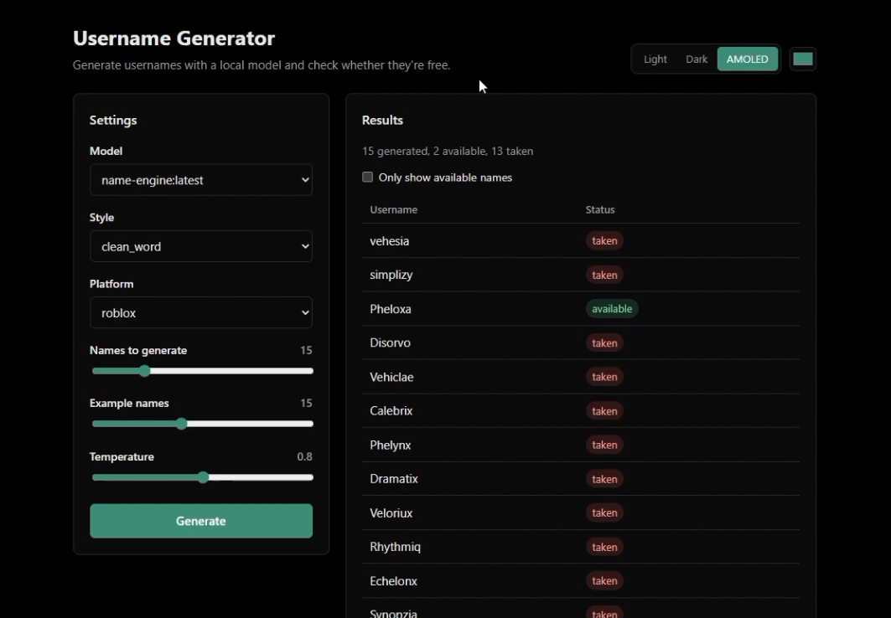

# Username Generator

Generate original, human-sounding usernames with a **local LLM** (via [Ollama](https://ollama.com)), styled after a curated dataset of real usernames, and check instantly which ones are still free on Roblox.




## Features

- **Runs fully locally:** works with any model installed in Ollama, no API keys or rate limits.
- **5 username styles** learned from a dataset of ~1150 real usernames: `clean_word`, `compound_phrase`, `short_tag`, `alphanumeric_id`, `abstract_glitch`.
- **Platform-aware:** prompt rules, allowed characters and length limits adapt to the chosen platform (Any, Roblox, TikTok).
- **Roblox availability check:** every name is checked in a single request, with an "only show available" filter.
- **Quality filters:** rejects copies and near-copies of the dataset, names stitched together from the shown examples, overused AI clichés ("flux", "nebula", ...) and plain dictionary words. If too many names are rejected, the model is asked again.
- **Adjustable settings:** model, style, platform, number of names, number of examples and temperature.
- Light, dark and AMOLED themes with a custom accent color.

## How it works

1. The page sends your settings to a small Flask server.
2. The server picks random example names of the chosen style and builds a prompt with a style description and the platform's username rules.
3. The local model generates a list of names.
4. The names are cleaned and filtered (up to 3 rounds to fill the requested count).
5. For Roblox, the names are checked against Roblox's public username lookup.
6. Results come back as JSON and are shown in a table with status badges.

## Requirements

- Python 3.10+
- [Ollama](https://ollama.com) with `llama3.1` (or any other model)
- Optional: the `wamerican` word list for the real-word filter (Linux/WSL)

## Setup

```bash
# 1. Get a model and create the tuned "name-engine" model
ollama pull llama3.1
ollama create name-engine -f Modelfile

# 2. Install the Python packages (ideally in a virtual environment)
python3 -m venv venv
source venv/bin/activate
pip install flask requests ollama

# 3. Optional: word list for the real-word filter
sudo apt install wamerican

# 4. Run the app
flask run
```

Then open http://localhost:5000.

> **Note on networking:** this project was developed in WSL with Ollama running on the Windows side, so `generator.py` looks up the Windows host's IP (`get_host()`). If you run Python and Ollama on the same machine (native Linux, macOS, or Windows without WSL), set `HOST = "localhost"` in `generator.py`.

## Project structure

```
app.py                  Flask routes: "/" (page) and "/generate" (JSON)
helpers.py              validates settings, lists models, runs one generation
generator.py            prompt building, model calls and filters
platforms.py            per-platform rules, name cleaning, Roblox check
data.py                 loads and cleans the dataset for the copy checks
thematic_usernames.csv  the dataset (columns: username, style)
Modelfile               the "name-engine" model setup
templates/              layout.html, index.html
static/                 script.js, theme.js, styles.css
```

## Customizing

- **Filters:** edit `CLICHES`, `USE_EXTRA_FILTERS` and `MAX_TRIES` in `generator.py`.
- **Styles:** add rows with a new `style` value to the CSV, plus a description in `STYLE_GUIDES` in `generator.py`.
- **Platforms:** add an entry to `PLATFORMS` in `platforms.py`.
- **Slider limits:** edit `LIMITS` in `helpers.py`.

## Limitations

- Only Roblox can be checked. TikTok has no public username lookup, so those names show as "not checked".
- "Available" means no account currently uses the name. Roblox may still block it (filtered or reserved names).
- Output quality depends on the model. Small models work but tend to fall back to generic names.

## Credits

- Sample usernames come from a Roblox community group dedicated to rating usernames.
- The first prototype and the Modelfile were made with Gemini. The app was built with help from Claude.
- Made as a final project for [CS50x](https://cs50.harvard.edu/x/).
